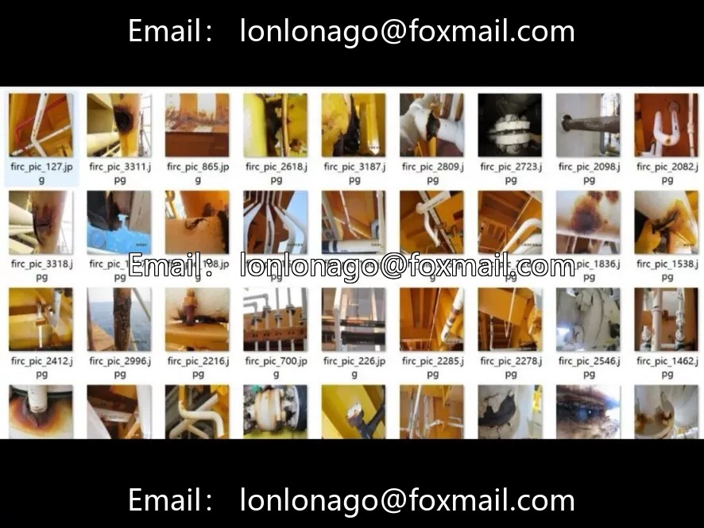

# Steel Pipe Corrosion Defect Detection Dataset

## Body

Steel Pipe Corrosion and Defect Detection Data Set

The dataset contains 3,344 images of industrial pipeline surface defects, all labeled as "defect" category, with a total of 20,932 bounding boxes. The high defect coverage makes it suitable for the automated recognition and evaluation of pipeline rust, corrosion, etc.

Task Type: Object Detection
Total Images: 3,344
Number of Categories: 1 (defect)
Annotation Format: Pascal VOC (XML) + YOLO (TXT)
Image Resolution: Unified 640×640
Annotation Tool: LabelImg
Data Partitioning: Not partitioned; user needs to partition it themselves.

Suitable for industrial pipeline inspection, facility maintenance, quality testing, etc. Supports mainstream target detection frameworks, dual format compatibility. It is recommended to split the training/validation/test set at a ratio of 8:1:1 or 7:1.5:1.5. Data augmentation can be performed according to different lighting conditions, metal reflection, and rust degree to enhance model robustness.

Virtual materials, once sold, are non-refundable.
Interested friends, click "I want" to proceed.

## Images

## Payment

Here is a pay link on Stripe ( https://buy.stripe.com/3cs8yP7sY87d0vu9AB ). Please contact me lonlonago@foxmail.com after funding $89, and I will send you a complete data files , thank you!

